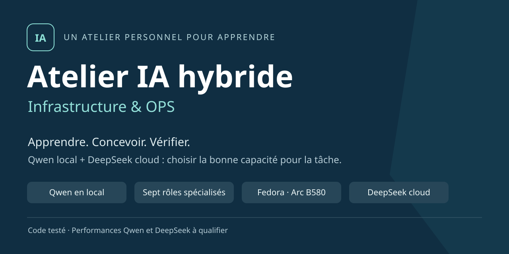

# Atelier IA hybride — Infrastructure & OPS

<p align="center"></p>

[](https://github.com/mathiasseguincadiche/OPENCLAW_LOCAL_FEDORA/actions/workflows/ci.yml)
[](https://github.com/mathiasseguincadiche/OPENCLAW_LOCAL_FEDORA/actions/workflows/codeql.yml)
[](https://fedoraproject.org/)
[](LICENSE)

**Un atelier IA personnel pour apprendre, préparer et documenter des projets DevOps sur Fedora.** Un assistant en ligne classique reçoit tes questions sur un service distant et propose des commandes qu'on n'a pas toujours le temps de comprendre. Cet atelier fait le choix inverse : le modèle **Qwen 3.5 9B tourne sur ton PC par défaut**, il explique avant de proposer, et c'est **toi** qui exécutes. OpenClaw organise sept rôles autour de ce modèle local ; **DeepSeek via OpenRouter** apporte une route cloud facultative, sur autorisation explicite.

[Découvrir](docs/GUIDE.md) · [Tester en Live USB](docs/LIVE_USB_FEDORA45_PREQUALIFICATION.md) · [Installer](docs/INSTALLATION_SIMPLE_FEDORA45.md) · [Documentation](docs/README.md) · [État du projet](STATUS.md)

> **En qualification : le PC cible reste à valider.** Les défauts relevés par l'audit du 27 octobre sont corrigés et testés en CI ([audit et corrections](docs/AUDIT_SOURCE_2026_10_27.md)). Le projet n'a pas encore tourné sur le PC : la [liste de contrôle de réception](docs/RECEPTION_ETAPE3.md) décrit cette campagne.

## État en un coup d'œil

« Implémenté » signifie présent dans le code ; ce n'est pas « vérifié sur le PC ». Le détail et les dates sont dans [STATUS](STATUS.md).

| Élément | Avancement | Contrôle | Preuve et portée |
| --- | --- | --- | --- |
| Code, règles et tests automatisés | Implémenté | Vérifié en CI (instantané du 3 novembre) et en local (9 novembre) | [STATUS](STATUS.md) ; un test réussi n'est pas un essai sur Fedora |
| Installation et réception sur le PC (Fedora 45, Intel Arc B580) | À faire | Non vérifié | [Liste de contrôle de réception](docs/RECEPTION_ETAPE3.md) |
| Qwen local : débit, VRAM, contexte 32K | Implémenté | À mesurer | [Premiers essais](docs/fiches/02-premier-essai.md) |
| Route cloud DeepSeek avec un vrai fournisseur | Implémenté, testé avec un faux fournisseur | Non vérifié : appel réel, coût et facturation à faire | [Fiche cloud](docs/fiches/12-cloud.md) |

## Ce que tu peux faire

- **Discuter et apprendre** : poser une question ou analyser de petits fichiers sans créer de projet.
- **Préparer une infrastructure** : architectures, configurations, scripts, runbooks et points de contrôle.
- **Organiser un projet** : sources, plan, tâches, validations humaines et livrables persistants.
- **Rédiger et vérifier** : Markdown, exports PDF/DOCX/ODT, schémas Draw.io et audits de cohérence.

Les sept rôles n'ont aucun outil pour exécuter une commande ni écrire un fichier à ta place : l'IA explique et propose, et les actions sensibles comme la livraison restent soumises à ta validation. L'atelier ne déploie pas automatiquement l'infrastructure préparée.

## Trois façons de travailler

| Interface | Usage |
| --- | --- |
| **Open WebUI 0.12.3** — `http://127.0.0.1:3000` | Le chat : rôles, pièces jointes et six raccourcis pour les projets |
| **Atelier Projets** — `http://127.0.0.1:18890` | Les sources, étapes, décisions et livrables |
| **Terminal** — `./menu.sh` | Installation, contrôles, services et maintenance ; [CLI des projets](docs/fiches/04-atelier-projets.md#en-ligne-de-commande) |

Les projets restent indépendants. Une seule génération utilise le moteur à la fois. Le chat répond en un bloc par défaut ; le streaming reste expérimental.

## Commencer

Le parcours complet est : essai facultatif en Live USB, installation, contrôle rapide, puis réception. Chaque étape a son guide ; ce README ne garde que le premier geste.

### 1. Facultatif : essayer Fedora sur la machine

Un essai préalable possible utilise **Fedora 45 Workstation / GNOME 51 / Wayland en Live USB**. Le contrôle autonome observe le matériel sans installer l'atelier :

```bash
# Depuis une copie du dépôt dans la session Live, sans sudo
bash scripts/linux/16_live_usb_preflight.sh
```

Suivre le [guide Live USB](docs/LIVE_USB_FEDORA45_PREQUALIFICATION.md) pour préparer le média et conserver le rapport. **Un résultat favorable préqualifie le matériel ; il ne valide pas encore OpenClaw, Qwen ou WebUI.** La date de publication de Fedora doit être vérifiée sur le site officiel avant de choisir l'ISO.

### 2. Installer l'atelier

Sur Fedora installé, suivre le [guide d'installation](docs/INSTALLATION_SIMPLE_FEDORA45.md), qui regroupe la préparation du stockage, le précontrôle, l'installation et la création du compte WebUI. Le runtime et ses projets utilisent **`/data/IA/Openclaw/`**, sur le disque secondaire EXT4.

**Machine cible :** Ryzen 7 7700, 48 Go de RAM, Intel Arc B580 12 Go. Fedora est le système hôte du projet IA ; Open WebUI tourne sous Podman rootless sur ce même Fedora. Aucune installation de Rocky Linux n'est nécessaire. [Stockage et prérequis](docs/STOCKAGE_DATA.md).

### 3. Vérifier, puis réceptionner

Après installation et configuration de WebUI, depuis le dépôt :

```bash
./menu.sh --action quick-check
```

Si le contrôle affiche `RECEPTION=READY_FOR_FIRST_PROJECT`, poser une vraie question dans WebUI et créer un petit projet de test, puis suivre la [liste de contrôle de réception](docs/RECEPTION_ETAPE3.md). Ce qui reste à prouver est indiqué dans [STATUS](STATUS.md).

## Local au quotidien, cloud sur décision

Qwen travaille sur la machine avec Ollama. DeepSeek V4.1 Flash constitue une option pour les dossiers complexes, et **DeepSeek V4 Pro** une option de raisonnement profond choisie explicitement par l'opérateur : aucun repli automatique du local vers le cloud. L'activation, les accords de projet et le budget sont contrôlés par la passerelle locale ; le plafond configuré est de **25 €/mois**, à compléter par une limite fournisseur et du prépaiement.

Une recherche Web peut contacter Internet même avec Qwen local. Le [mode Web privé](docs/WEB_ACCESS_PRIVATE_MODE.md) désactive ces outils. Le filtre de confidentialité reste une aide ; il ne garantit pas qu'un contenu autorisé pour le cloud soit publiable.

[Comprendre les deux routes](docs/ARCHITECTURE_HYBRIDE.md) · [Activer le cloud](docs/fiches/12-cloud.md) · [Sécurité](SECURITY.md)

## Sept rôles, un même atelier

Mentor infrastructure/OPS · Expert recherche · Architecte solutions · Ingénieur DevOps · Ingénieur sécurité · Rédacteur pédagogique · Auditeur qualité.

Chaque rôle reçoit ses consignes et ses outils autorisés. [Découvrir leurs responsabilités](docs/fiches/07-roles-et-outils.md) · [Voir l'architecture](docs/fiches/11-comment-ca-marche.md).

## Ce qui vient d'où

L'atelier assemble des composants tiers et y ajoute son propre code. La distinction compte pour juger ce qui a été développé ici.

| Origine | Éléments | Rôle dans l'atelier |
| --- | --- | --- |
| **Composants tiers**, versions épinglées | OpenClaw 2026.10.5, Ollama 0.40.6, Open WebUI 0.12.3, modèle Qwen 3.5 9B, DeepSeek via OpenRouter | Agents, inférence locale, interface de chat, modèles |
| **Ce dépôt** | Paquet Python `clawfedora` (`src/`), scripts d'installation et de maintenance (`scripts/`), consignes des sept rôles (`agents/`), politiques (`config/`), plugins (`plugins/`), tests (`tests/`), documentation (`docs/`) | Passerelle cloud, moteur de projets, contrôles, installation, pédagogie |

Les versions exactes sont dans [`config/runtime_versions.yaml`](config/runtime_versions.yaml) et expliquées dans [les références techniques](docs/reference/README.md).

## Limites connues

- **Pas encore essayé sur le PC cible** : toutes les mesures réelles (GPU, WebUI dans le navigateur, voix, restauration) restent à faire.
- **Pas de déploiement autonome** : les fichiers proposés par les agents ne prouvent pas qu'un Terraform ou un Ansible a réussi.
- **Usage prévu : une personne, sur son propre PC.** L'atelier n'est pas conçu pour être exposé sur un réseau ; les sauvegardes locales ne sont pas chiffrées ([Sécurité](SECURITY.md)).
- **Qualité des réponses non mesurée** : la comparaison Qwen, DeepSeek et Gemini repose sur une grille humaine ([Évaluation pédagogique](docs/EVALUATION_PEDAGOGIE.md)), sans note automatique.

## Trois points à retenir

1. Le modèle est **local par défaut** ; le cloud est une option désactivée, activée par toi, projet par projet.
2. Le modèle propose, le moteur encadre, **tu valides et tu exécutes**.
3. Le code est testé automatiquement, mais **le PC Fedora n'a pas encore réceptionné l'atelier**.

## Documentation

| Besoin | Guide |
| --- | --- |
| Prendre en main le chat et les projets | [Discussion](docs/fiches/03-discuter.md) · [Atelier Projets](docs/fiches/04-atelier-projets.md) |
| Produire ou importer des documents | [Fichiers, exports et schémas](docs/fiches/06-fichiers-et-schemas.md) |
| Juger la qualité des explications | [Évaluation pédagogique](docs/EVALUATION_PEDAGOGIE.md) |
| Diagnostiquer ou préparer la réception | [Dépannage](docs/fiches/10-depanner.md) · [Validation](docs/validation/README.md) |
| Comprendre les versions et protections | [Références techniques](docs/reference/README.md) · [État et limites](STATUS.md) |

## Informations pratiques

Licence [MIT](LICENSE) · Auteur : [mathiasseguincadiche](https://github.com/mathiasseguincadiche) · [Contribuer](CONTRIBUTING.md) · [Historique](CHANGELOG.md) · [Signaler une faille](SECURITY.md#signaler-un-problème) · [Code de conduite](CODE_OF_CONDUCT.md)
