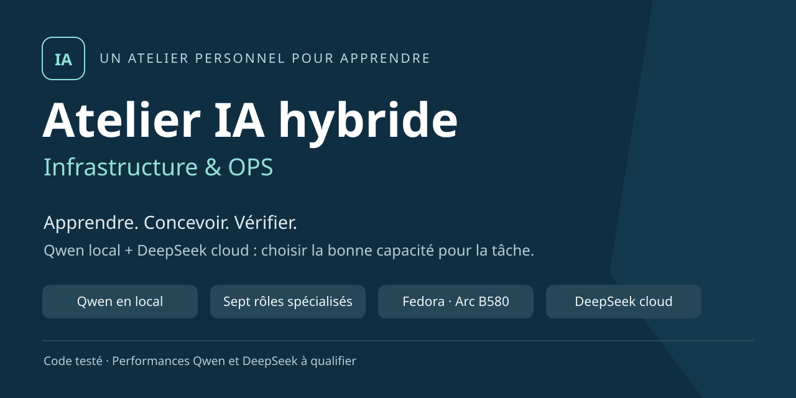
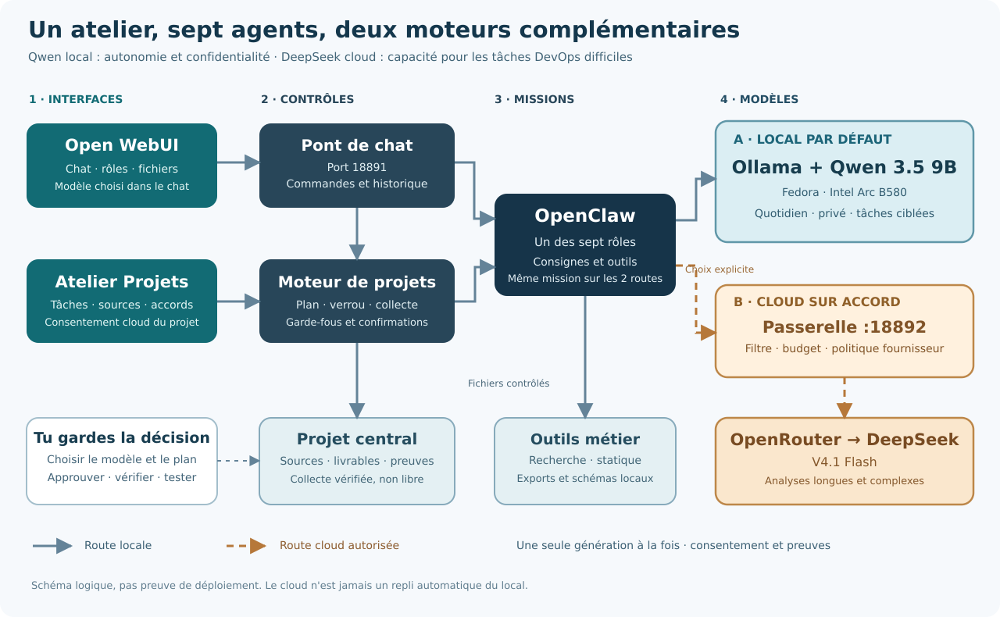

# Atelier IA hybride — Infrastructure & OPS

<p align="center"></p>

[](https://github.com/mathiasseguincadiche/OPENCLAW_LOCAL_FEDORA/actions/workflows/ci.yml)
[](https://github.com/mathiasseguincadiche/OPENCLAW_LOCAL_FEDORA/actions/workflows/codeql.yml)
[](https://fedoraproject.org/)
[](LICENSE)

**Un atelier IA personnel conçu pour apprendre le DevOps infrastructure, préparer des déploiements, analyser des configurations et mener plusieurs projets documentés.** Sept rôles OpenClaw partagent un moteur **Qwen 3.5 9B local**, avec **DeepSeek V4.1 Flash 1017 via OpenRouter** comme option cloud explicitement autorisée.

> **État actuel :** CI logicielle opérationnelle ; **le PC cible reste à valider**. Les tests automatisés ne prouvent pas encore les performances réelles de l'Intel Arc B580, le navigateur, la voix ni la facturation cloud. [État détaillé](STATUS.md).

## Ce que l'atelier permet de faire

| Besoin | Résultat visé |
| --- | --- |
| **Comprendre** Linux, réseau, Terraform, Ansible | Explications adaptées, exemples, exercices seulement sur demande |
| **Préparer** une infrastructure | Architecture, scripts, configurations, runbooks et points de contrôle |
| **Travailler sur un projet** | Sources, plan, tâches, approbations, état persistant et livrables |
| **Vérifier** la qualité | Audit de risques, cohérence et rapports de preuves sans déploiement implicite |
| **Documenter** un résultat | Markdown éditable, exports PDF/DOCX et schémas Draw.io |

Le chat peut aussi analyser de petits fichiers texte **sans créer de projet**. Les projets restent indépendants ; une seule génération d'inférence est exécutée à la fois pour préserver la B580 et sa VRAM.

## Comment ça fonctionne



**Deux routes, sept spécialités, validation humaine.** OpenClaw fournit les consignes et les outils autorisés aux rôles ; Ollama fait tourner le modèle local et la passerelle cloud vérifie les conditions d'accès à DeepSeek. Les outils proposés ne disposent pas d'un accès libre au terminal ni d'un droit de déploiement sur l'hôte.

| Composant | Fonction | État initial |
| --- | --- | --- |
| **Qwen 3.5 9B Q4_K_M + Ollama** | Réponses locales, GPU Intel Arc B580/Vulkan | Actif par défaut après installation |
| **DeepSeek V4.1 Flash 1017 + OpenRouter** | Analyse de dossiers complexes et longs contextes | Cloud **désactivé** avant activation explicite |
| **OpenClaw** | Coordination, outils contrôlés et consignes des rôles | Sept rôles spécialisés |
| **Open WebUI** | Interface de discussion : `127.0.0.1:3000` | Podman rootless |
| **Atelier Projets** | Organisation et suivi : `127.0.0.1:18890` | Projets indépendants |

**Les sept rôles :** Mentor infrastructure/OPS, Expert recherche, Architecte solutions, Ingénieur DevOps, Ingénieur sécurité, Rédacteur pédagogique et Auditeur qualité.


**Documentation contrôlée :** [sommaire et sources de vérité](docs/README.md) · [audit transversal du 20 octobre 2026](docs/AUDIT_DOCUMENTATION_2026_10.md). Les plans historiques restent des archives ; les essais Fedora/cloud restent à réaliser.

**Qualification de la pédagogie :** quatre dimensions (clarté, profondeur, interactivité, exactitude), scénarios de discussion sur trois tours et score humain /20, sans appel automatique au cloud. [Protocole](docs/EVALUATION_PEDAGOGIE.md).

**Pédagogie et sobriété :** les consignes privilégient une réponse utile, un petit exemple OPS et une vérification concrète plutôt que des pages répétitives. Les profils cloud `rapide`, `equilibre` et `approfondi` sont choisis manuellement ; `approfondi` reste le défaut historique. [Consignes](docs/PROMPTS.md) · [Réglages](docs/fiches/08-reglages.md).

**Sécurité et consentement :** aucun repli automatique du local vers le cloud. Le budget configuré est plafonné à **25 €/mois**, complété par un prépaiement et une limite chez le fournisseur. Les outils de recherche Web peuvent contacter Internet **même si Qwen est local** ; le [mode Web privé](docs/WEB_ACCESS_PRIVATE_MODE.md) permet de les désactiver explicitement avec `./menu.sh --action web-private --apply`, après installation. Le filtre de confidentialité ne peut pas garantir qu'aucune information sensible ne sortira si l'utilisateur autorise le cloud.

→ [Architecture détaillée](docs/fiches/11-comment-ca-marche.md) · [Pourquoi Qwen et DeepSeek ?](docs/ARCHITECTURE_HYBRIDE.md) · [Outils des rôles](docs/fiches/07-roles-et-outils.md)

## Installation : le chemin le plus court

**Plateforme visée :** Fedora 45 Workstation, GNOME 51, Wayland, AMD Ryzen 7 7700, 48 Go RAM, Intel Arc B580 12 Go. Fedora est le système hôte du projet IA. **Aucune installation de Rocky Linux** ou VM n'est nécessaire ; Open WebUI tourne sous **Podman rootless sur ce même Fedora**.

1. Installer Fedora 45 Workstation sur le SSD système après sa publication officielle.
2. Monter le **disque secondaire** de façon permanente sur `/IA` (via UUID). Ne pas formater un disque contenant des données.
3. Vérifier `findmnt --mountpoint /IA` avant tout `--apply`. Le runtime est `/IA/Openclaw/`. Ne pas reformater un disque contenant des données ; l'installateur ne prépare pas le partitionnement pour toi.

**Précontrôles dans un terminal de la session GNOME Wayland** (les valeurs attendues sont Fedora 45, GNOME 51, `wayland`, SELinux `Enforcing` et un volume distinct monté sous `/IA`) :

```bash
cat /etc/fedora-release
gnome-shell --version
printf 'Session : %s\n' "${XDG_SESSION_TYPE:-inconnue}"
getenforce
findmnt --mountpoint /IA
df -h /IA
```

**Vérifie les sorties avant de poursuivre.** Si `git` n'est pas déjà installé sur ton Fedora neuf, installe-le une seule fois avec la commande ci-dessous. Le gestionnaire de paquets peut demander ton mot de passe sudo ; les autres paquets sont ensuite gérés par l'installateur.

```bash
command -v git >/dev/null 2>&1 || sudo dnf5 install -y git
cd "$HOME"
git clone https://github.com/mathiasseguincadiche/OPENCLAW_LOCAL_FEDORA.git
cd "$HOME/OPENCLAW_LOCAL_FEDORA"

./menu.sh --action install               # affiche le plan, ne teste PAS le matériel
./menu.sh --action install --apply       # installation autorisée, peut demander sudo
```

Le lanceur **`menu.sh` est le seul point d'entrée à utiliser** pour cette première installation : inutile d'exécuter manuellement `scripts/linux/00_bootstrap.sh` ou `06_install.sh`. Si le dossier existe déjà, n'exécute pas `git clone` une seconde fois : ouvre ce dossier et examine ses modifications avant de le mettre à jour. La commande `install` sans `--apply` n'est **pas** un diagnostic Fedora/GPU complet ; les vrais prérequis sont vérifiés pendant `--apply`. L'installateur installe et verrouille OpenClaw, Ollama et Qwen, mais **n'active pas le cloud**.

Se reconnecter à la session Fedora pour appliquer les groupes GPU `render`/`video`, puis :

```bash
./menu.sh --action webui-install --apply
# Créer le compte administrateur à http://127.0.0.1:3000
./menu.sh --action webui-seal --apply
./menu.sh --action quick-check
```

**Si `RECEPTION=READY_FOR_FIRST_PROJECT`**, ouvrir Open WebUI, poser une question réelle et créer un petit projet. Le contrôle réalise **une génération locale courte**, vérifie GPU, modèles, services, interfaces et stockage. Pas de stress test 32K ou d'appel cloud imposé. En cas d'échec, consulter le [diagnostic](docs/fiches/10-depanner.md), sans tout réinstaller.

**Ensuite, facultativement :** pour utiliser DeepSeek via ta clé OpenRouter, suivre [l'activation cloud contrôlée](docs/fiches/12-cloud.md#activer-le-cloud). Ce n'est ni une condition du premier démarrage local ni un appel cloud automatique. Pour diagnostiquer un échec, consulter [la fiche dépannage](docs/fiches/10-depanner.md).

[**Guide d'installation détaillé et stockage `/IA/Openclaw`**](docs/INSTALLATION_SIMPLE_FEDORA45.md)

## Où vont les données ?

```text
/IA/Openclaw/
├── models/ollama/       # modèle IA local
├── projects/            # projets, sources et livrables
├── workspaces/          # espaces des agents
├── state/               # configurations, WebUI et états locaux
├── runtime/             # environnement Python géré
├── proofs/              # rapports
└── backups/             # sauvegardes (à copier aussi hors du disque)
```

Les exécutables système, certaines données npm et le stockage Podman peuvent résider hors de `/IA/Openclaw`. Le démarrage des services gérés est conditionné au montage de `/IA`.

## État, limites et documentation

- **Vérifié automatiquement :** contrats Fedora 45, Python, scripts shell, politiques des rôles, intégration native OpenClaw, régressions et CodeQL. Les versions sélectionnées sont définies dans [la configuration](config/runtime_versions.yaml) et [la politique WebUI](config/webui_policy.yaml) (Open WebUI 0.12.3).
- **Verrouillage des dépendances :** [production Python avec SHA-256 et npm avec SHA-512](docs/PYTHON_RUNTIME_LOCK.md), avec fermetures séparées pour la production et les 21 paquets de voix, et des limites documentées pour les dépendances de build PEP 517.
- **À qualifier sur le PC réel :** performances et stabilité B580, navigateur, micro/voix, projets complets, backups réels et appels OpenRouter avec coût mesuré. Le projet **n'a pas encore tourné sur le PC** dans le cadre de la réception prévue.
- **Limites connues :** une seule génération à la fois ; streaming token par token préparé en canary, désactivé par défaut ; l'IA conseille et prépare mais ne déploie pas les infrastructures proposées.

| Commencer | Approfondir |
| --- | --- |
| [Sommaire de la documentation](docs/README.md) | [Architecture et flux](docs/fiches/11-comment-ca-marche.md) |
| [Guide pédagogique](docs/GUIDE.md) | [Les sept rôles et leurs outils](docs/fiches/07-roles-et-outils.md) |
| [Premier projet DevOps](docs/EXEMPLE_PARCOURS_DEVOPS.md) | [Cloud, consentement et budget](docs/fiches/12-cloud.md) |
| [Installer et vérifier](docs/INSTALLATION_SIMPLE_FEDORA45.md) | [Validation technique facultative](docs/validation/README.md) |
| [État vérifié et limites](STATUS.md) | [Historique et anciennes décisions](docs/archives/2026/README.md) |

[Contribuer](CONTRIBUTING.md) · [Sécurité](SECURITY.md) · [Historique](CHANGELOG.md) · [Licence MIT](LICENSE)

> **Principe du projet :** l'IA explique et propose ; les règles encadrent, les preuves sont vérifiables, l'humain décide.
