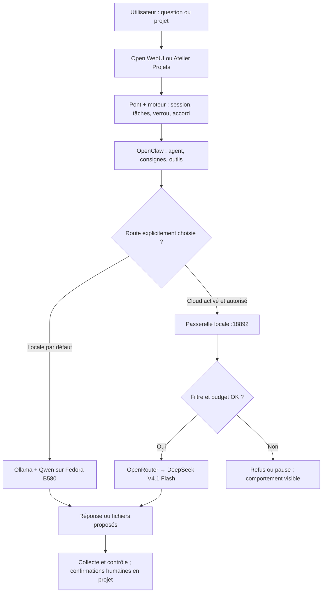

# Pourquoi l'Atelier IA est **hybride** — Qwen local + DeepSeek cloud

[← Guide](GUIDE.md) · [README](../README.md) · [Sept agents](fiches/07-roles-et-outils.md) · [Décision de modèle](DECISION_MODELE.md)

## L'idée de départ

Un PC Fedora avec une **Intel Arc B580 (12 Go)** peut faire tourner un modèle compact : **Qwen 3.5 9B Q4_K_M**. Il est utile pour expliquer, structurer, rédiger et raisonner sur des tâches ciblées, **sans transmettre la conversation à un service d'inférence distant**.

Mais les besoins DevOps ne s'arrêtent pas aux petites questions : auditer plusieurs modules Terraform, comprendre une CI cassée à plusieurs endroits, confronter des choix d'architecture ou produire un dossier cohérent exigent parfois **plus de contexte et de capacité de raisonnement**.

C'est précisément **la raison d'être de DeepSeek V4.1 Flash** dans ce projet : fournir **une route de capacité pour les tâches difficiles**, sans abandonner le contrôle local, la transparence des appels ou le budget.

> **Le but n'est pas d'être « 100 % local à tout prix » ni « 100 % cloud ». Le but est de faire un travail DevOps utile, compréhensible et vérifiable, en choisissant le bon niveau de ressources.**

## Les deux moteurs ont des missions complémentaires

| | **Qwen local** | **DeepSeek cloud** |
|---|---|---|
| Rôle dans la stratégie | Socle du quotidien, confidentialité, autonomie | Renfort de raisonnement et de contexte pour les tâches complexes |
| Où la demande est traitée | Ollama sur le PC Fedora, modèle `qwen3.5:9b-q4_K_M` | OpenRouter vers `deepseek/deepseek-v4.1-flash`, après passerelle locale |
| Ressources | GPU B580, VRAM à mesurer | Service distant, requêtes facturées |
| Contexte déclaré dans les politiques | **32 768 tokens** ; sortie **4 096** | **1 048 576 tokens** ; sortie **32 768** |
| Documents métiers privés | À privilégier ; attention aux recherches Web demandées | **Ne pas envoyer** sans certitude sur les droits, la confidentialité et l'accord de projet |
| Ce que cela apporte | Pas de coût API marginal, contrôle matériel, travail hors API cloud | Potentiellement moins d'erreurs ou de reprises sur de longues tâches, plus de matière à analyser |
| Ce qui reste à mesurer | Vitesse, qualité et usage réel GPU | Gain de qualité/temps, routage OpenRouter réel, coûts et compatibilité |

Ces valeurs sont les **limites configurées**, pas la preuve d'un résultat obtenu. Un contexte déclaré à 1 M de tokens ne signifie pas qu'une tâche consomme automatiquement 1 M de tokens.

## Aide au choix intégrée, sans appel à un modèle

Dans Open WebUI, le raccourci **Quel modèle choisir ?** et la commande
`!modele` présentent les critères de choix **de manière déterministe**.
Des catégories courtes comme `!modele iac` ou `!modele confidentiel`
affichent une recommandation motivée. Le programme n'examine pas le contenu
du chat et ne décide jamais qu'une conversation est sans danger pour le cloud.

C'est **une aide manuelle**, pas une sélection automatique ni un classificateur
de données privées. Elle ne consomme aucune requête Qwen ou DeepSeek et ne
modifie ni le budget ni les accords de projet.

## En pratique : quand solliciter quel modèle ?

Ce tableau donne des **critères de choix**, pas des résultats de benchmark déjà mesurés.

| Situation | Route conseillée | Pourquoi |
|---|---|---|
| Expliquer `systemctl`, corriger un petit extrait YAML, décrire le rôle d'Ansible | **Qwen local** | Demande courte ; le cloud n'apporte pas nécessairement de valeur |
| Revoir des notes personnelles, un inventaire de machines privées ou une configuration avec noms internes | **Qwen local** | Le risque de divulgation prévaut sur le gain potentiel |
| Comparer publiquement deux architectures Azure, leurs limites et une stratégie de rollback | **DeepSeek** si autorisé | Raisonnement multi-critères et synthèse longue |
| Relire plusieurs fichiers Terraform publics, des dépendances et un plan CI/CD complexe | **DeepSeek** si autorisé | Meilleure capacité attendue pour relier plusieurs contraintes |
| Diagnostiquer un échec de pipeline difficile à partir de journaux **assainis et publiables** | **DeepSeek** si autorisé | Analyse croisée ; une réponse demeure à prouver dans la vraie CI |
| Rédiger une courte procédure de sauvegarde | **Qwen local** | Travail borné, coût API inutile |
| Produire un dossier long : ADR, runbook, risques, scénarios d'échec, relecture croisée | **DeepSeek** si les sources sont autorisées ; sinon **Qwen par sections** | Le cloud peut améliorer la cohérence d'ensemble, mais jamais au détriment de la confidentialité |

**Règle de rendement :** utiliser DeepSeek quand le **gain attendu de qualité et de temps** dépasse le coût de la requête **et** que les données peuvent légalement et raisonnablement sortir du PC. Le gain n'est **pas** mesuré à ce jour : le comparer à Qwen sur les mêmes tâches fait partie de la qualification.

## Sept agents, deux moteurs d'inférence

Un **agent OpenClaw** ne contient pas son propre modèle : c'est une mission (mentor, recherche, architecte, DevOps, sécurité, rédacteur, auditeur), des consignes et des outils. Les **mêmes sept rôles** sont compatibles avec les deux routes configurées dans `config/core/model_routing.yaml`.

| Question | Ce qui change avec le rôle | Ce qui change avec le modèle |
|---|---|---|
| « Qui travaille ? » | Mission, méthode, outils autorisés, livrables attendus | Rien |
| « Où et avec quelles capacités ? » | Rien | Qwen local ou DeepSeek distant, contexte, coût et confidentialité |
| « Qui décide d'envoyer au cloud ? » | Aucun agent ne peut décider seul | **L'utilisateur**, via choix explicite / autorisation du projet |
| « Les agents peuvent-ils lancer une commande ? » | Non, outils `exec`/`write` interdits | Non sur les deux routes |
| « L'auditeur devient-il indépendant en cloud ? » | Session séparée | **Pas automatiquement :** si le modèle est identique, la limite d'indépendance demeure |

**Important :** le système n'utilise **pas encore** un routeur intelligent qui mesure la difficulté et déplace automatiquement une tâche de Qwen à DeepSeek. C'est une **stratégie de choix de modèle** expliquée à l'utilisateur et appliquée par les mécanismes d'autorisation existants.

## Le parcours technique des deux routes

Cette représentation est **logique** : le trajet réel exact dépend du chat ou du worker. Elle ne démontre pas qu'une installation Fedora et OpenRouter a été testée.

### 1. Dans Open WebUI

Le chat expose une route « **· local** » et, après activation du cloud, une route « **· cloud (DeepSeek)** ». **C'est le choix de modèle qui demande la capacité cloud** ; un message complexe ne provoque pas automatiquement une migration Qwen → DeepSeek.

Si un **projet est sélectionné**, son contexte n'est autorisé au cloud que s'il possède l'**accord cloud valide** lié à ses sources. Une question indépendante sur un nouveau fil ne donne pas droit à exporter le contenu d'un projet.

### 2. Dans Atelier Projets

Le **plan approuvé** détermine quels spécialistes contribuent, mais **l'accord cloud est au niveau du projet**, pas un bouton de routage Qwen/DeepSeek pour chaque agent. Les étapes cloud d'un projet autorisé utilisent les mêmes outils et les mêmes règles métier ; si la route cloud ne peut pas poursuivre, le projet **se met en pause** plutôt que de repartir en local sans accord.

**Conséquence importante pour l'efficacité :** si une seule étape est complexe, le mécanisme actuel ne garantit pas qu'elle seule sera facturée en cloud. Le routage automatique fin par tâche est une **amélioration éventuelle à concevoir**, avec validation humaine et règles de protection ; ne pas annoncer cette optimisation comme déjà implémentée.

## Pourquoi la passerelle cloud est indispensable

OpenClaw n'envoie pas directement la clé OpenRouter à DeepSeek. Il appelle un **service local** qui effectue des contrôles **avant** chaque appel facturable, y compris dans les boucles d'outils.

1. **Activation** : filtre de confidentialité **et** budget doivent être opérationnels ensemble.
2. **Autorisation** : route explicitement demandée ; dans un projet, consentement couvrant les sources.
3. **Contrôle du contenu** : recherche de secrets dans le corps du message, les consignes, le contexte et les **résultats des outils**. Un filtre de secrets **ne reconnaît pas tout document confidentiel**.
4. **Budget** : réservation prudente **avant** l'appel, plafond de **25 €/mois** ; crédits prépayés, limite de clé chez OpenRouter et rapprochement du coût réel.
5. **Fournisseur** : contraintes de traitement des données, paramètres requis et plafonds de prix ; refus plutôt qu'assouplissement silencieux.
6. **Traçabilité** : coût réel s'il est disponible ; estimation conservatrice en cas d'incertitude.

Des fichiers contenant des données professionnelles sensibles ou privées peuvent être impropres au cloud **même s'ils ne contiennent pas de mot de passe**. Les **images** ne sont pas envoyées au cloud dans le projet actuel.

## Le budget n'est pas l'ennemi de l'efficacité

Le budget existe pour faire de DeepSeek un **outil ciblé**, pas pour interdire son usage :

- privilégier Qwen sur les demandes simples évite des appels payants ;
- réserver DeepSeek aux tâches de raisonnement difficiles peut éviter plusieurs reprises laborieuses ;
- la passerelle applique une estimation **prudente**, qui n'est **pas** une facture garantie ;
- l'optimisation doit être mesurée en **qualité du résultat, nombre de corrections, délai de résolution et coût réel**, et pas uniquement en tokens.

La politique déclare `reasoning.effort=xhigh` pour DeepSeek et un plafond de prix. Ce réglage vise la qualité du raisonnement, **pas nécessairement la latence minimale** : il peut augmenter la durée ou le coût selon les requêtes. Le débit, l'acceptation des paramètres et le coût réel restent à vérifier avec le fournisseur.

## Ce qui est réellement implémenté — et ce qui ne l'est pas

| Fonction | Statut dans le dépôt |
|---|---|
| Deux routes déclarées (Qwen, DeepSeek) pour les sept rôles | **Implémenté dans les politiques** |
| Cloud désactivé par défaut ; activation contrôlée | **Implémenté et testé avec faux fournisseur** |
| Choix visible dans le chat ; accord cloud par projet | **Implémenté dans le code**, comportement navigateur réel à vérifier |
| Contrôle secrets, budget et frais conservateurs | **Tests automatisés**, facturation OpenRouter réelle non vérifiée |
| Sélection automatique du meilleur modèle **par tâche** | **Non implémentée** |
| Preuve de supériorité de DeepSeek sur les projets de l'utilisateur | **À mesurer** |
| Streaming token par token dans Open WebUI | **Non implémenté** |
| Qualification Fedora/B580, web UI et OpenRouter réels | **À faire** |

→ [Décision technique sur le modèle](DECISION_MODELE.md) · [Activation et protection du cloud](fiches/12-cloud.md) · [État factuel](../STATUS.md).

## Méthode de comparaison raisonnable

Pour savoir où DeepSeek apporte **réellement** une meilleure efficacité, préparer **quelques tâches DevOps publiques identiques**, sans données personnelles : un module Terraform, une revue de CI, un ADR, un runbook et un diagnostic de configuration.

Mesurer pour **chaque route** : précision technique, contradictions, pédagogie, fichiers nécessaires, nombre de corrections, durée et coût API. Un verdict « meilleur » doit provenir de ces observations, **pas d'un benchmark marketing ou d'une intuition**.

**Conclusion : Qwen assure le socle local ; DeepSeek fournit la capacité cloud quand elle est utile et autorisée ; OpenClaw distribue l'expertise des agents ; l'humain garde le dernier mot.**
