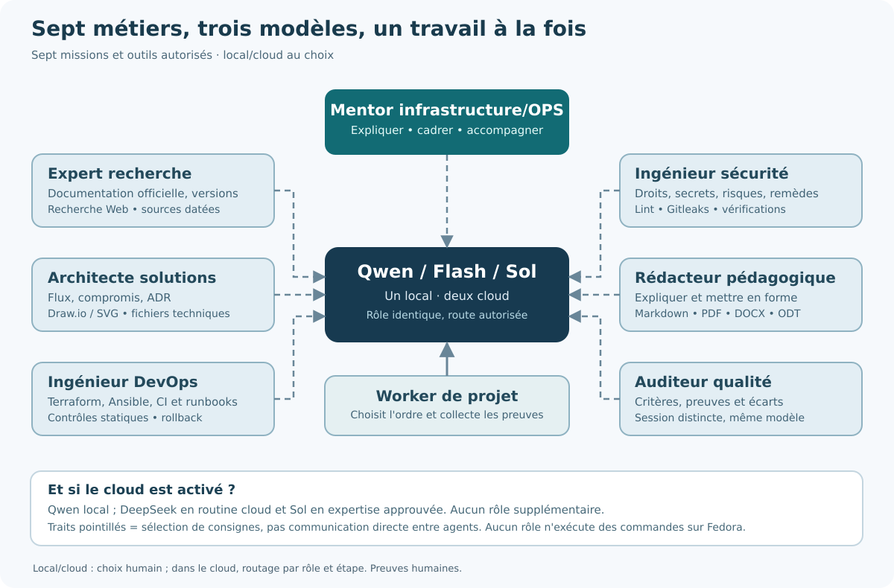
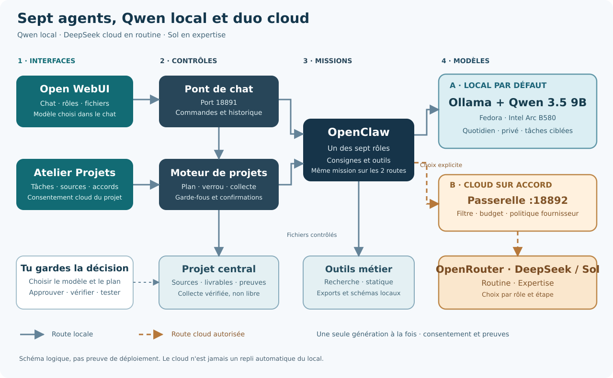

# Découvrir l'Atelier IA **local** Fedora — guide pas à pas

[← Accueil du dépôt](../README.md)

**Objectif de ce guide :** comprendre la répartition **Qwen 3.5 9B + Ornith 1.5 9B + Gemma 4 12B**, savoir quel agent solliciter et distinguer ce qui est **proposé** de ce qui est **réellement vérifié**. Pas besoin de connaître OpenClaw pour commencer.

**Pour mesurer ta progression dans la qualité des réponses** : [scénarios multi-tours et notation clarté/profondeur/interactivité/exactitude sur 20](EVALUATION_PEDAGOGIE.md). C'est une grille humaine, pas une note calculée par l'IA ni une garantie de supériorité face à Gemini.

## 1. Pourquoi un atelier plutôt qu'un simple chatbot ?

Tu peux utiliser l'IA de deux façons :

- **Pour une question rapide** : « Pourquoi Terraform a-t-il un fichier d'état ? ». Tu choisis un rôle, tu lis la réponse et tu peux demander un exemple.
- **Pour un vrai travail DevOps** : « Prépare l'architecture, les fichiers, les contrôles et le guide d'un déploiement ». Tu crées un projet avec des étapes, des rôles et des validations.

L'atelier est conçu pour apprendre **en comprenant**. Tu peux demander une réponse complète : **aucun exercice ni questionnaire n'est obligatoire**. Si tu souhaites pratiquer, il existe un mode guidé sur consentement.

### Les trois choses à retenir

1. **Trois modèles locaux.** Qwen assure le mentorat, Gemma la recherche, l'architecture, la sécurité, la documentation et l'audit ; Ornith est affecté à l'ingénieur DevOps.
2. **Sept agents sont sept métiers, pas sept modèles.** Le worker applique les règles de coordination ; les outils effectuent les vérifications, l'humain approuve les opérations sensibles.
3. **OpenRouter est retiré.** Aucune route de modèles cloud n'est disponible. La recherche Web de *sources* reste un outil distinct, désactivable depuis le mode privé.

→ **[Architecture locale, modèles et qualification](ARCHITECTURE_LOCALE_QWEN_ORNITH.md)**.



## 2. L'architecture en image



La demande arrive dans **l'atelier natif unique** (`127.0.0.1:18890`) : Discussions, Projets, GitHub et Notion. Le worker sélectionne le rôle autorisé, qui utilise Qwen, Ornith ou Gemma via Ollama. Les fichiers générés ne constituent pas des preuves d'exécution.

| Partie | Rôle dans le système |
|---|---|
| **Atelier natif** | Interface unique Discussions · Projets · GitHub · Notion |
| **OpenClaw + worker** | Missions, permissions, orchestration et confirmations |
| **Ollama / Qwen** | Compréhension, mentorat et vision | 
| **Ollama / Gemma** | Recherche, architecture, sécurité, rédaction et audit |
| **Ollama / Ornith** | Code, IaC, CI et diagnostics techniques |
| **Vérifications** | Lint, rapports, reçus, preuves humaines ; aucun shell général ouvert par défaut |

→ [Sept agents](fiches/07-roles-et-outils.md) · [Architecture détaillée](ARCHITECTURE_LOCALE_QWEN_ORNITH.md).

## 3. Premier scénario : une question simple

Tu ouvres **l'Atelier natif** (`http://127.0.0.1:18890`), ouvres Discussions et sélectionnes **Mentor infrastructure/OPS** et demandes :

> Je connais les services systemd et les scripts Bash. Explique-moi ce qu'Ansible apporte, avec un exemple simple, ce qu'il faut vérifier et ses limites.

Le mentor peut expliquer le vocabulaire et le mécanisme, puis proposer un exemple **non exécuté**. S'il te manque une version précise d'Ansible, tu peux sélectionner **Expert recherche** pour obtenir des sources datées.

**À essayer ensuite :** « Explique chaque ligne du YAML que tu proposes, puis indique ce que tu ne peux pas vérifier depuis cette conversation. »

→ [Discuter](fiches/03-discuter.md) · [Apprendre](fiches/05-apprendre.md).

## 4. Deuxième scénario : un petit projet à plusieurs étapes

Pour une application Linux à déployer, l'intérêt est de ne pas mélanger architecture, scripts, sécurité et relecture.

1. **Tu crées le projet** et joins son objectif et, si besoin, des documents sources.
2. **Le mentor cadre**, recherche les informations manquantes et propose un plan court.
3. **Tu approuves** l'analyse puis les tâches utiles (par exemple architecte et DevOps).
4. **Le worker distribue** les tâches dans l'ordre prévu. Il n'y a pas sept agents en parallèle.
5. **Le spécialiste propose** un résultat et une méthode pour le vérifier. Le collecteur contrôle les fichiers attendus.
6. **L'auditeur relit** les critères et les preuves. S'il manque une preuve, le travail doit être repris.
7. **Tu approuves la livraison**. Si une application doit être réellement installée, c'est **toi** qui exécutes et observes l'opération dans ton laboratoire.

**Règle pratique :** si tu as déjà un fichier `.tf` et veux seulement comprendre son contenu, **ne crée pas un projet**. Pour un extrait court sans secret, colle le texte utile dans le fil ; pour les documents de référence, utilise les imports du projet.

→ [Parcours DevOps commenté, du besoin au livrable](EXEMPLE_PARCOURS_DEVOPS.md) · [Piloter les projets](fiches/04-atelier-projets.md).

## 5. Quel rôle choisir ?

| Situation | Rôle conseillé |
|---|---|
| Je veux comprendre ou je suis bloqué | **Mentor** |
| Je veux une documentation officielle récente | **Expert recherche** |
| Je dois choisir une architecture et comprendre les flux | **Architecte** |
| Je dois préparer Terraform, Ansible, Bash ou une CI | **DevOps** |
| Je veux vérifier droits, secrets ou exposition réseau | **Sécurité** |
| Je veux un guide clair, lisible et exportable | **Rédacteur** |
| Je veux savoir si une exigence est **prouvée** | **Auditeur** |

→ [Voir les outils exacts et leurs restrictions](fiches/07-roles-et-outils.md).

## 6. Préparer et installer Fedora

**Premier essai prévu :** démarrer Fedora 45 Workstation / GNOME 51 en Live USB
et suivre le [contrôle matériel autonome](LIVE_USB_FEDORA45_PREQUALIFICATION.md).
Cette étape ne teste pas encore OpenClaw, Qwen ou WebUI ; elle ne nécessite aucune
installation de l'atelier ni écriture sur les SSD internes par le script.

**Pour l'atelier complet :** suivre ensuite le [guide d'installation unique](INSTALLATION_SIMPLE_FEDORA45.md)
sur Fedora installé, avec le disque secondaire monté sous **`/data`** et le runtime
**`/data/IA/Openclaw/`**. Le guide regroupe les prérequis, le clonage, les contrôles,
l'installation et la reconnexion nécessaire avant l'atelier natif.

Après installation et ouverture de la session Fedora, depuis le dépôt :

```bash
./menu.sh --action quick-check
```

Un résultat `READY_FOR_FIRST_PROJECT` ouvre le premier essai de discussion et de petit
projet. Il reste à vérifier les [défauts ouverts de l'audit](AUDIT_SOURCE_2026_10_27.md),
les réponses réelles et la restauration avant de considérer l'atelier fiable au quotidien.
Les benchmarks et canaries restent facultatifs.

→ [Réception détaillée et limites des preuves](validation/README.md).

## 7. Documents, dessins et validations : ne pas mélanger

- **Markdown** : la source éditable d'un guide. Le PDF, le DOCX et l’ODT sont des exports issus de cette source.
- **Draw.io** : le schéma éditable de l'architecte. Le SVG n'est qu'un aperçu qui ne se resynchronise pas automatiquement.
- **Contrôle statique** : peut signaler des erreurs JSON/YAML/Python, Bash, Markdown ou secrets selon l'agent. La sandbox Ornith peut aussi lancer des validateurs Terraform et Ansible Lint hors réseau, sur une tâche approuvée ; ni apply ni déploiement réel.
- **Preuve d'exécution** : un résultat réellement obtenu sur la plateforme cible, daté et attribuable à la bonne version.
- **Livraison** : fichiers attendus, critères et approbation humaine ; elle ne certifie pas que ton infrastructure externe est en production.

→ [Fichiers, limites et Draw.io](fiches/06-fichiers-et-schemas.md).

## 8. Choisir le bon modèle local

| Situation | Agent / modèle | Pourquoi |
|---|---|---|
| Apprendre Linux, Ansible, expliquer le fonctionnement des VM | Mentor / **Qwen** | Compréhension, guidage et pédagogie |
| Définir les frontières, ADR et schémas | Architecte / **Gemma** | Synthèse des contraintes et compromis |
| Préparer ou corriger Terraform, CI, Bash, K3s | DevOps / **Ornith** | Programmation agentique et diagnostics |
| Vérifier sécurité et qualité d'une réalisation | Sécurité ou auditeur / **Gemma** | Contrôle sur résultats externes vérifiables |

Les modèles sont exécutés localement, l'un après l'autre. Un autre spécialiste peut être sollicité après un plan approuvé ; aucun changement de modèle n'augmente les permissions d'outils.

→ [Architecture locale Qwen/Ornith](ARCHITECTURE_LOCALE_QWEN_ORNITH.md) · [Retrait de l'ancien OpenRouter](fiches/12-cloud.md).

## 9. Quel est le vrai niveau de maturité ?

Le code et les tests automatiques existent. Les performances GPU, la vraie compatibilité du chat natif, la voix, les uploads, la restauration et les trois modèles locaux doivent encore être **essayés sur le PC Fedora**. Le streaming SSE est préparé mais désactivé par défaut ; aucune installation ou migration Open WebUI n'est requise pour une installation neuve de l'atelier natif.

→ [État actuel](../STATUS.md) · [Validation facultative](validation/README.md) · [Historique des plans](archives/2026/README.md).

## La bibliothèque, par besoin

| Pour quoi faire ? | Fiche |
|---|---|
| Installer | [01 — Installer](fiches/01-installer.md) |
| Contrôler le GPU et les performances | [02 — Premier essai](fiches/02-premier-essai.md) |
| Discuter, charger un petit fichier, utiliser les commandes | [03 — Discuter](fiches/03-discuter.md) |
| Gérer les sources, les tâches et les approbations | [04 — Atelier Projets](fiches/04-atelier-projets.md) |
| Comprendre sans exercices imposés | [05 — Apprendre](fiches/05-apprendre.md) |
| Produire PDF, DOCX, ODT, Terraform et Draw.io | [06 — Fichiers et schémas](fiches/06-fichiers-et-schemas.md) |
| Choisir un agent et comprendre ses outils | [07 — Rôles et outils](fiches/07-roles-et-outils.md) |
| Configurer les limites | [08 — Réglages](fiches/08-reglages.md) |
| Sauvegarder et mettre à jour | [09 — Entretenir](fiches/09-entretenir.md) |
| Diagnostiquer | [10 — Dépanner](fiches/10-depanner.md) |
| Comprendre les composants et flux | [11 — Comment ça marche](fiches/11-comment-ca-marche.md) |
| Comprendre le retrait des modèles cloud | [12 — Historique du cloud](fiches/12-cloud.md) |

**Pour retenir l'essentiel :** **le modèle propose ; le moteur encadre et collecte ; tu vérifies et approuves.**
