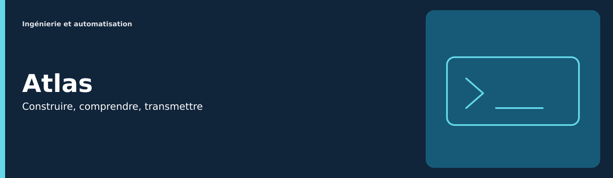
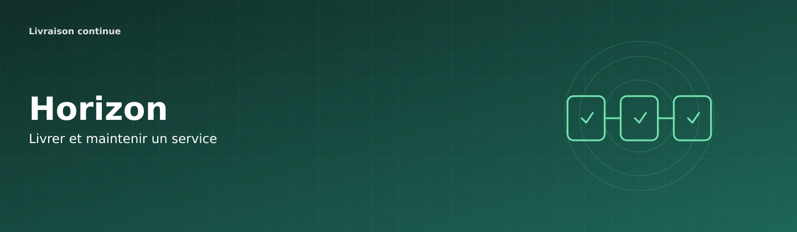
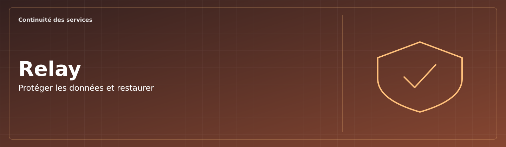

# Studio graphique avancé — galerie de recette

Trois identités fictives, trois compositions distinctes. Les SVG et les
sources JSON sont vérifiés par le test de régénération. Ces visuels
ne sont pas des captures, et leur rendu natif n'est pas encore qualifié.

## Editorial — Atlas

## Orbit — Horizon

## Blueprint — Relay

[Standard graphique](../../GRAPHIC_STUDIO.md)
