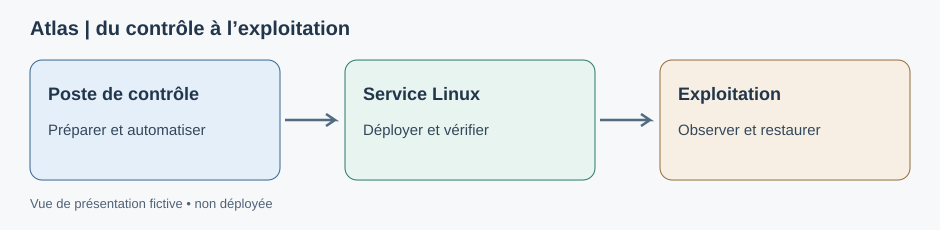

# Atelier Atlas

**Déployer un service Linux reproductible, l’observer et prouver sa reprise.**

> Projet fictif — exemple éditorial, aucune infrastructure réalisée.

[Comprendre](#comprendre) · [Commencer](#commencer) · [Architecture](#architecture) · [État et preuves](#état-et-preuves)

## Comprendre

Une équipe doit livrer un service de consultation interne sans configurer chaque serveur manuellement. Atlas illustre le passage d'une installation manuelle à une infrastructure reproductible, puis à son exploitation.

| Besoin | Réponse de conception |
| --- | --- |
| Reproduire l'environnement | Configuration déclarative versionnée |
| Détecter une dégradation | Sondes et métriques |
| Rétablir le service | Sauvegarde indépendante et restauration testée |

## Commencer

Avant toute installation, identifier le système, l’espace libre et les outils présents. Ne pas installer une seconde copie d’un outil sans vérifier sa version.

~~~bash
# Afficher le système et l'espace disponible (lecture seule).
cat /etc/os-release
df -h
~~~

Résultat attendu : identifier la distribution et les volumes disponibles. Ces commandes ne provisionnent aucun serveur. Aucune sortie n'a été exécutée pour cette démonstration.

## Architecture

[Source Draw.io éditable](atlas-presentation.drawio) · Vue de présentation seulement ; la vue technique détaillerait flux, droits et stockage.

## État et preuves

| Réalisation | Avancement | Qualification |
| --- | --- | --- |
| Architecture de démonstration | Proposée | Non vérifiée |
| Provisionnement | Prévu | Non exécuté |
| Service et supervision | Prévus | Non exécutés |
| Restauration | Prévue | Non exécutée |

## Limites

Pas de preuve CI, pas de capture d'application, pas de validation sur une machine. Une maquette n'atteste aucune compétence.

[Retour aux démonstrations](README.md)
