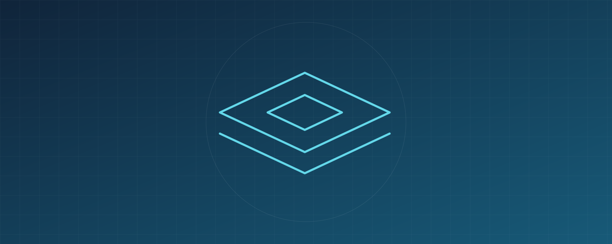
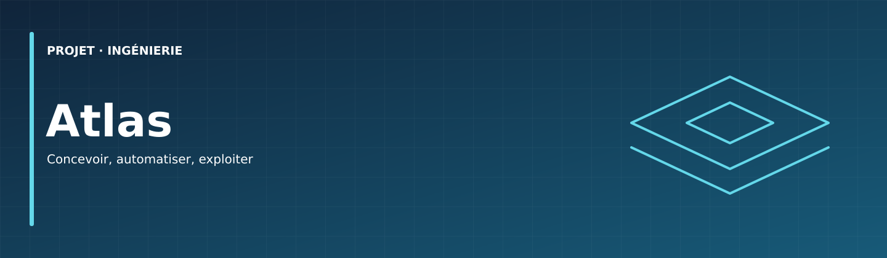
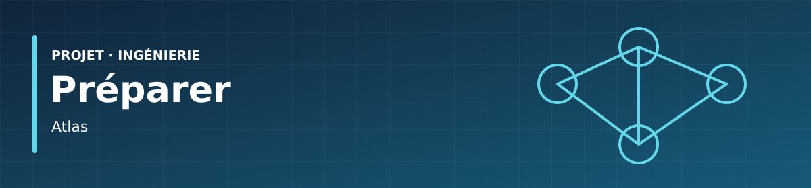
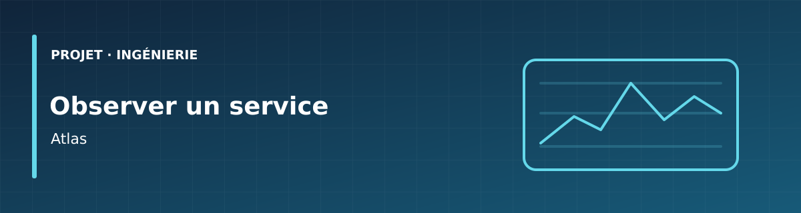
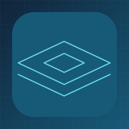
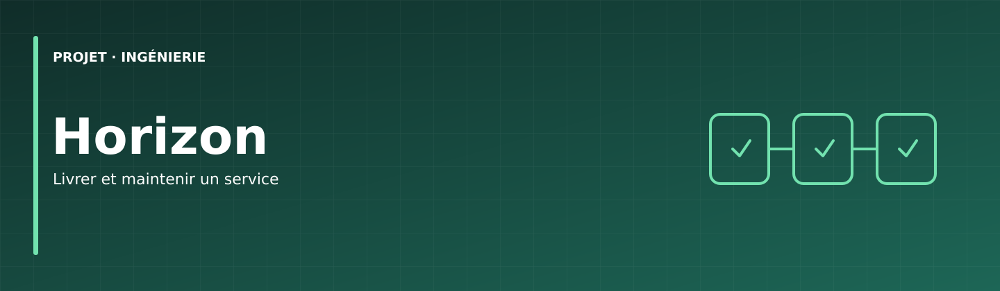
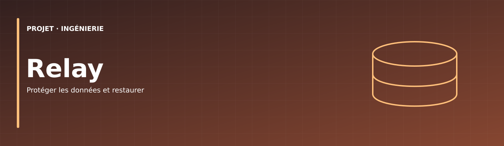

# Galerie éditoriale Premium V2

Illustrations de trois projets fictifs : aucune topologie, capture applicative ou preuve de déploiement. Les paires JSON/SVG sont des références de recette du moteur graphique : la CI vérifie leur régénération exacte. Le rendu natif reste à inspecter.

## Atlas — une identité, cinq déclinaisons

## Deux directions artistiques distinctes

Sources éditables : les fichiers JSON de même nom. Les motifs sont des illustrations, pas des schémas techniques.
