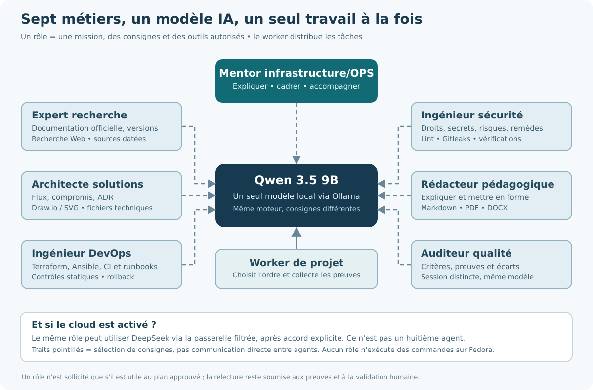

# Les sept rôles et leurs outils — qui fait quoi ?

[← Guide](../GUIDE.md) · [Architecture expliquée](11-comment-ca-marche.md) · [Exemple concret](../EXEMPLE_PARCOURS_DEVOPS.md)

## D'abord, comprendre le mot « agent »

Imagine une **équipe de sept spécialités** réunie autour d'un même dossier : elle dispose **de deux moteurs d'inférence complémentaires**, mais garde les mêmes missions et outils autorisés.

- **Qwen local** : traitement quotidien privé, raisonnements ciblés, zéro coût API.
- **DeepSeek V4.1 Flash 1017 cloud** : **capacité de raisonnement et contexte renforcés**, prévus pour les tâches complexes, les analyses longues et les contributions multi-fichiers qui le justifient.
- **OpenClaw + worker** : une couche commune de consignes, outils, ordonnanceur et protections. Les sept agents **ne constituent pas sept modèles distincts**.

La route cloud n'est ni obligatoire ni choisie automatiquement par agent. [Stratégie hybride et cas d'usage](../ARCHITECTURE_HYBRIDE.md).

- **Le modèle** est le moteur qui rédige et raisonne : **Qwen 3.5 9B Q4_K_M** via Ollama en local, ou **DeepSeek V4.1 Flash 1017** via OpenRouter si tu as activé le cloud et autorisé son usage.
- **Le rôle** indique la mission, les règles et les outils auxquels le modèle a droit. Changer de rôle **ne change pas automatiquement de modèle**.
- **Le worker** (moteur du projet) choisit l'ordre des tâches, fournit les éléments autorisés et récupère les résultats. Les agents **ne s'appellent pas entre eux**.
- **Toi** : tu approuves les étapes et décides si le résultat convient. Un fichier rédigé n'est pas un logiciel installé.



**Un point crucial :** les agents qui travaillent en local emploient **le même modèle** Qwen. Le cloud, lorsqu'il est autorisé, change la route d'inférence mais pas les règles d'accès aux outils. Un audit sur une session distincte ne devient pas indépendant simplement parce que le nom du rôle change.

### Quelle route pour quel spécialiste ?

**DeepSeek ne remplace pas un spécialiste.** Il peut apporter **davantage de capacité au même spécialiste** pour une mission difficile — par exemple le DevOps sur plusieurs modules Terraform, l'architecte sur une topologie multi-contraintes, le mentor sur une explication publique complexe ou l'auditeur sur un dossier long. Les outils disponibles restent ceux du rôle.

| Agent | Qwen local : exemple | DeepSeek cloud : exemple, si le contenu est autorisé |
|---|---|---|
| Mentor | Explication d'Ansible ou de systemd | Relier plusieurs concepts complexes d'architecture/CI et pédagogie détaillée |
| Recherche | Collecte ciblée de sources officielles | Synthèse critique de nombreuses sources publiques contradictoires |
| Architecte | Petit diagramme réseau, ADR simple | Comparaison multi-critères de scénarios d'infrastructure |
| DevOps | Relecture d'un petit YAML, runbook | Cohérence de plusieurs modules Terraform/Ansible et workflow CI/CD |
| Sécurité | Vérification statique d'une configuration locale privée | Revue documentaire approfondie d'un ensemble public assaini |
| Rédacteur | Fiche courte ou compte-rendu interne | Document public long et cohérence interchapitres |
| Auditeur | Vérification de quelques critères | Confrontation de nombreux critères et preuves **autorisées à sortir** |

**Ce sont des usages visés, pas des performances déjà mesurées.** Dans un projet, l'accord cloud s'applique **au projet**, pas aux seules tâches de ce tableau : le worker ne bascule pas automatiquement entre Qwen et DeepSeek selon le rôle.

**Un projet n'a pas besoin des sept agents.** Pour une question Linux simple, le mentor suffit. Pour un pipeline sensible, DevOps + sécurité + audit peuvent être utiles. Ajouter des agents inutilement **augmente les générations, la durée et éventuellement le coût cloud**.

## Choisir le bon interlocuteur

| Besoin | Commence par | À lui demander |
|---|---|---|
| « Pourquoi utiliser Ansible plutôt qu'un script Bash ? » | **Mentor** | Une explication avec un exemple concret |
| « La syntaxe a-t-elle changé dans cette version ? » | **Recherche** | Une source officielle datée et les points à vérifier |
| « Comment organiser Azure, le réseau et les flux ? » | **Architecte** | Deux options, un ADR et un schéma |
| « Écris un pipeline et explique chaque étape » | **DevOps** | Fichiers séparés, validations et rollback |
| « Quels secrets ou ports peuvent poser problème ? » | **Sécurité** | Menaces, preuves et mesures proportionnées |
| « Prépare un runbook clair à présenter » | **Rédacteur** | Markdown éditable, exports PDF/DOCX |
| « Est-ce vraiment conforme aux exigences ? » | **Auditeur** | Critères, preuves manquantes et verdict |

Le modèle peut se tromper : **un bon choix de rôle améliore le cadrage, pas la certitude**.

## Les outils communs : la boîte à outils de base

| Outil ou famille | Ce qu'il fait | Ce qu'il ne prouve **pas** |
|---|---|---|
| `read`, `pdf`, `view_image` | Lit des fichiers accessibles dans le périmètre du rôle, des PDF/images pris en charge | Que toutes les pages ou pièces ont été ingérées |
| `web_search`, `web_fetch` | Recherche jusqu'à **4 résultats** et extrait jusqu'à **4 000 caractères** par page selon la politique | Qu'une information récente est vraie sans source datée |
| `clawfedora_search` | Cherche des passages dans l'index local des documents du projet (au plus 4 passages) | Qu'un PDF scanné a été intégralement lu |
| `clawfedora_outline` | Propose une **trame métier** : brief, ADR, runbook, audit, etc. | Que la trame est un document terminé |
| `clawfedora_ci_report` | Lit/interprète un rapport de CI fourni | Que le rapport vient bien d'une exécution authentifiée |
| `clawfedora_tool_status` | Signale les outils et formats accessibles selon le rôle | Que le logiciel externe a été exécuté |
| `clawfedora_artifact` | Produit de vrais fichiers locaux : Markdown/TXT et exports PDF/DOCX/TXT | Que le texte est exact, testé ou déployé |

Les fichiers et pages Web sont des **sources**, pas des instructions capables de changer les règles de sécurité.

## Les outils spécialisés : des droits différents

| Outil | Qui peut l'utiliser | Son vrai périmètre |
|---|---|---|
| `clawfedora_diagram` | **Architecte** | Schéma **Draw.io modifiable** et aperçu SVG ; environ **8 blocs et 12 liens** par appel |
| `clawfedora_artifact` en formats techniques | **Architecte, DevOps, Sécurité** | `.tf`, YAML/JSON, Bash/Python, Dockerfile, `.j2`, INI/TOML/XML : **produire**, pas exécuter |
| `clawfedora_check` | **DevOps, Sécurité, Auditeur** | Parsing/syntaxe statique de JSON, YAML et Python |
| `clawfedora_lint` | **DevOps, Sécurité, Auditeur** | ShellCheck/YAML/Markdown selon les contrôles accessibles ; **Gitleaks** pour Sécurité et Auditeur |
| `clawfedora_lint` (Markdown) | **Rédacteur** aussi | Qualité de forme Markdown, pas justesse technique |

La matrice d'accès qui fait foi est dans [`config/core/tool_policy.yaml`](../../config/core/tool_policy.yaml). Cette page explique le sens des droits ; la configuration **applique** les droits.

### 1. Mentor infrastructure/OPS — expliquer et cadrer

**Mission :** être le premier interlocuteur pour progresser du système/réseau vers le DevOps, résoudre un blocage et définir **la prochaine étape utile**.

**Sa méthode :** réponse directe par défaut → explication du mécanisme → exemple adapté → vérification à réaliser. Si un projet est nécessaire, il propose **1 à 4 tâches** et les critères, puis **attend ton approbation** avant l'affectation par le worker.

**Outils marquants :** lecture, recherche, `clawfedora_outline` (brief), `clawfedora_tool_status`, analyse de rapports CI, exports documentaires. Le mentor peut vérifier **le statut de sa session courante** (`session_status`), mais ne dispose plus de `sessions_list`, `sessions_history` ni `sessions_search`. La visibilité OpenClaw est explicitement limitée à `self` et la communication inter-agents native est désactivée ; c'est le worker, et non le modèle, qui remet les seules contributions approuvées aux spécialistes.

**Exemple :** « Je sais administrer systemd. Explique ce qu'une CI ajoute, avec un exemple et les erreurs fréquentes. »

**Sortie attendue :** une explication, les hypothèses et, si nécessaire, un mini-plan. **Pas** une certification de compétence.

### 2. Expert recherche — vérifier les faits et les versions

**Mission :** trouver des informations pertinentes **et vérifiables**, notamment sur Fedora, Linux, Azure, Terraform, Ansible, conteneurs et sécurité.

**Sa méthode :** poser la question vérifiable, privilégier docs officielles/changelogs, dater les sources, distinguer **confirmé / probable / à tester**. Une page Web n'atteste jamais que ton PC se comporte ainsi.

**Outils :** `web_search`, `web_fetch`, lecture, `clawfedora_search`, trame « sources », notes Markdown/PDF/DOCX.

**Exemple :** « Quelle version de Terraform documente cette option ? Donne la référence officielle et la date. »

**Sortie :** liens et extraits utiles, contradictions éventuelles et contrôle local suggéré.

### 3. Architecte solutions — relier les composants

**Mission :** concevoir une solution cohérente avec des contraintes de réseau, sécurité, exploitation, coût, sauvegarde et retour arrière.

**Sa méthode :** besoins → options → **ADR** (*Architecture Decision Record* : décision argumentée) → flux, ports, identités et risques → schéma.

**Outils :** `clawfedora_diagram`, trame ADR, recherche, exports et modèles de configuration technique.

**Exemple :** « Dessine les flux entre GitHub Actions, un registre de conteneurs et une VM Rocky Linux. Explique où passent les secrets. »

**Sortie :** un `.drawio` éditable, parfois un SVG d'aperçu, une décision et les vérifications à confier au DevOps. **Le schéma n'est pas une infrastructure déployée.**

### 4. Ingénieur DevOps — produire ce qu'on peut ensuite tester

**Mission :** préparer des configurations, scripts, pipelines et procédures pour **déployer et exploiter** correctement.

**Sa méthode :** prérequis et versions → fichiers utilisables → explication des blocs → validations à faire → surveillance et rollback.

**Outils :** `clawfedora_check` (syntaxe), `clawfedora_lint` (ShellCheck/yamllint/Markdown), `clawfedora_ci_report`, production `.tf`, YAML, scripts, Dockerfile, runbooks.

**Exemple :** « Prépare `main.tf`, `variables.tf` et un runbook. Explique `terraform init`, `plan`, `apply` et ce qui doit être contrôlé avant chaque étape. »

**Sortie :** fichiers et commandes **proposées**, jamais exécutées par l'agent. `terraform validate`, `ansible-lint`, `actionlint`, tests d'idempotence et déploiement réel restent **à exécuter ailleurs**, même si un outil statique renvoie PASS.

### 5. Ingénieur sécurité — trouver les défauts avant la panne

**Mission :** identifier des risques réels (droits excessifs, exposition réseau, secrets, dépendances, CI/CD, images, sauvegardes) sans désactiver les protections Fedora.

**Sa méthode :** définir le périmètre → décrire menace et impact → citer la preuve → classer le risque → proposer remédiation et vérification.

**Outils :** lecture, recherche, `clawfedora_check`, `clawfedora_lint` dont **Gitleaks** sur du texte autorisé, rapports et politiques techniques.

**Exemple :** « Relis ce YAML GitHub Actions : permissions du jeton, secrets, versions des actions et déclencheurs. »

**Sortie :** tableau des constats et remédiations. **Pas** un scan complet du PC ni une garantie d'absence de vulnérabilité. Ne fournis jamais de vraie clé API.

### 6. Rédacteur pédagogique — rendre le résultat transmissible

**Mission :** transformer les résultats **déjà vérifiés ou clairement qualifiés** en document qu'une autre personne peut comprendre et appliquer.

**Sa méthode :** public → contexte → prérequis → étapes → résultats attendus → erreurs possibles → retour arrière. Signaler les contradictions plutôt que les masquer.

**Outils :** lecture, recherche, trames « guide »/« explication », `clawfedora_lint` sur Markdown, `clawfedora_artifact` pour Markdown source et PDF/DOCX.

**Exemple :** « Fais un runbook compréhensible par un administrateur Linux qui découvre les pipelines. »

**Sortie :** documentation lisible et fichiers éditables ; **un beau document ne remplace pas une preuve technique**.

### 7. Auditeur qualité — refuser les succès non prouvés

**Mission :** comparer une livraison aux exigences du plan, aux preuves et aux contraintes de sécurité. Il **signale** les défauts : il ne corrige pas silencieusement le travail audité.

**Sa méthode :** exigence → critère mesurable → preuve consultée → résultat → écart précis → retest requis. Une preuve absente signifie **non démontré**, jamais un PASS inventé.

**Outils :** lecture, recherche, `clawfedora_check`, `clawfedora_lint` (dont Gitleaks), rapports CI et export de rapport.

**Exemple :** « Relis ce pipeline, le rapport de CI et la procédure de rollback. Quels critères sont vraiment validés ? »

**Sortie :** verdict, preuves et corrections à demander. Son avis est **séparé par session** de l'auteur, **pas indépendant par modèle**.

## Les limites communes à connaître

- **Pas de `exec`, `process`, `write`, `edit`, `apply_patch`** accordés aux rôles quotidiens : le modèle n'a pas un shell sur Fedora.
- Pas de navigateur autonome, pas de publication distante, pas d'élévation de privilèges, pas de création autonome de sous-agents.
- Le **collecteur du projet** seul inscrit les sorties autorisées dans les chemins prévus, avec contrôle des fichiers et empreintes.
- Un **lint PASS** prouve au mieux ce que le lint a examiné. Une **CI déclarée PASS** sans provenance n'est pas une preuve. Un PDF exporté ne démontre pas le déploiement qu'il décrit.
- **Une seule génération** à la fois, pour éviter la concurrence en mémoire vidéo.
- Pour le cloud : même rôle et outils, mais autorisation préalable, filtrage, coût et limites supplémentaires.

## Exemple : comment trois rôles se complètent

Tu demandes : « Je veux déployer une petite API sur une VM Rocky Linux, avec une CI sécurisée. »

1. **Architecte** : définit les flux et l'authentification, livre un ADR et un schéma.
2. **DevOps** : prépare les fichiers d'infrastructure et le workflow avec une procédure de validation/rollback.
3. **Sécurité** : examine secrets, ports, permissions et images.
4. **Auditeur** : compare le tout aux critères et preuves disponibles. Il peut demander de reprendre l'étape 2.
5. **Rédacteur**, seulement si tu demandes un dossier explicatif : assemble les décisions et les procédures.

**Le mentor** peut t'expliquer chaque étape ; **la recherche** intervient uniquement si des faits externes récents sont nécessaires. **C'est toujours le worker qui distribue les tâches approuvées** : cet exemple est une illustration, pas un ordre d'exécution automatique.

→ [Parcours détaillé d'une demande jusqu'à la livraison](../EXEMPLE_PARCOURS_DEVOPS.md).

## Où se trouvent les instructions véritables ?

```text
config/core/agents.yaml         identifiants et missions des 7 rôles
config/core/tool_policy.yaml    autorisations et interdictions des outils
agents/_shared/PEDAGOGY.md     règles pédagogiques communes
agents/_shared/CONTRACT.md     preuves, limites, honnêteté
agents/_shared/TOOLS.md        formats et règles des outils
agents/<identifiant>/AGENTS.md mission et méthode du spécialiste
src/clawfedora/project_worker.py  exécution ordonnée et collecte
```

À l'installation, les consignes communes et propres au rôle sont déployées dans son espace de travail. Modifie les sources du dépôt, puis valide avec `./menu.sh --action validate` avant de redéployer. Les consignes sont bornées par la taille du contexte.

[← Guide](../GUIDE.md) · [Fonctionnement détaillé →](11-comment-ca-marche.md)
